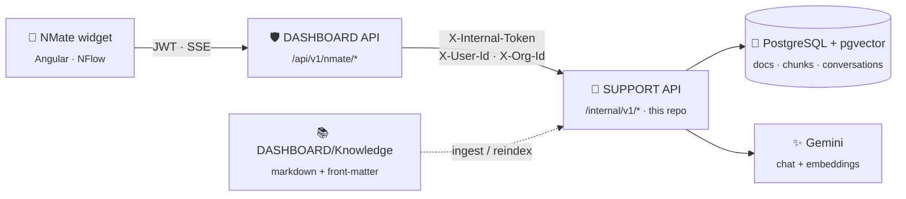
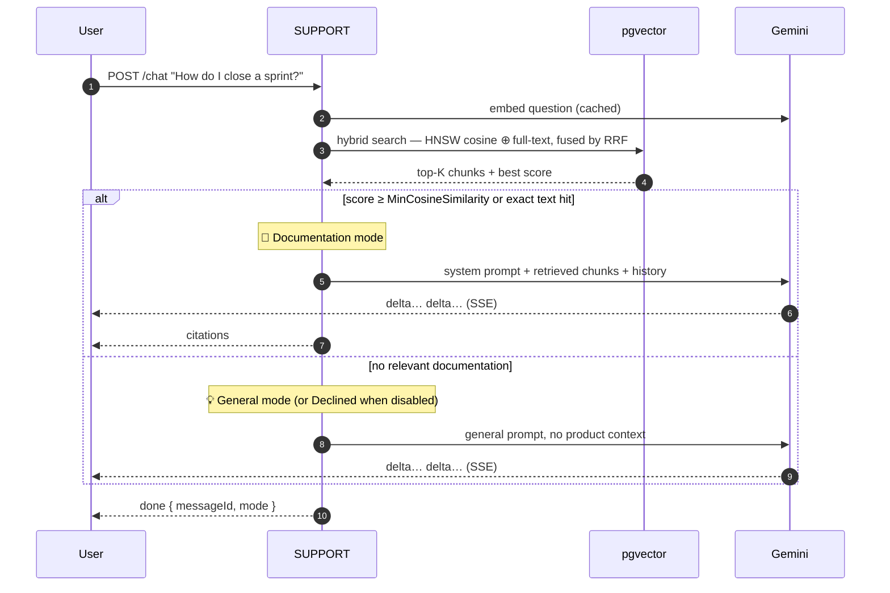
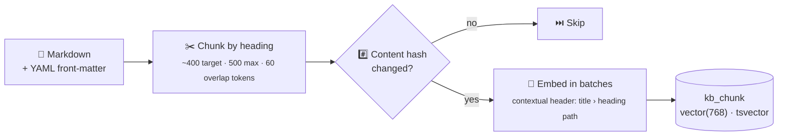
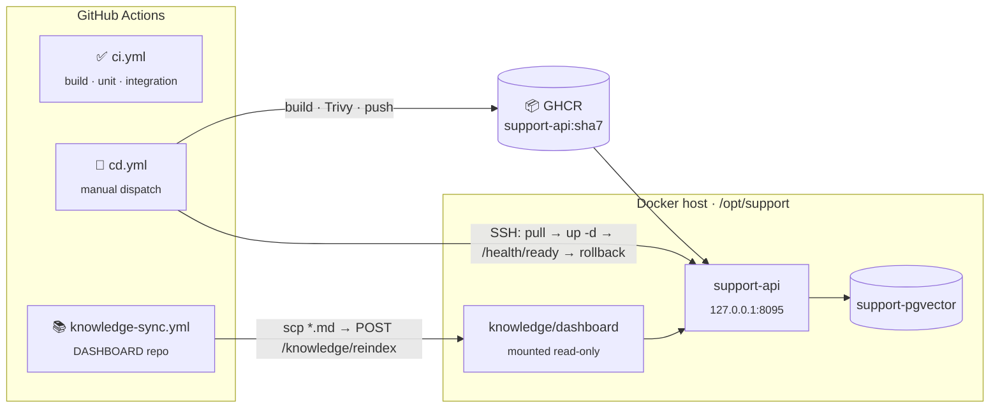

<div align="center">

# 🤖 NMate

### The AI support assistant of the Nexus product family

Answers *"how do I…"* questions about **NFlow** from the product's own documentation — grounded, cited, streamed —
and behaves like a general assistant when the docs have nothing to say.


[How it works](#-how-it-works) ·
[Quick start](#-quick-start) ·
[Configuration](#%EF%B8%8F-configuration) ·
[API](#-api) ·
[Deployment](#-deployment) ·
[Development](#-development)

</div>

---

> **Naming** — the repository, solution and namespaces are `SUPPORT`; **NMate** is the name users see.
> Sibling brands: **NFlow** (repo `DASHBOARD`) and **NHub** (repo `HUB`).

## ✨ Highlights

| | |
|---|---|
| 🎯 **Grounded answers** | Hybrid retrieval (vector + full-text, fused with RRF) and a relevance guard decide whether an answer may use the docs |
| 📎 **Citations** | Every documentation answer links back to the guide sections it was built from |
| 💬 **General knowledge fallback** | Off-topic questions get a normal assistant answer — clearly labelled, never presented as product fact |
| ⚡ **Streaming** | Server-Sent Events end to end; partial answers are persisted if the stream is cut |
| 🔁 **Incremental indexing** | Only documents whose content hash changed are re-embedded |
| 💸 **Free-tier friendly** | Batched embeddings, cached question vectors, one chat call per answer, no retry storms |
| 🔌 **Provider-agnostic** | Code depends on `IChatClient` / `IEmbeddingGenerator`; switching LLM is configuration |

## 🧭 How it works

### Architecture



DASHBOARD owns authentication and per-user rate limiting, then forwards the caller's identity.
SUPPORT is **internal only** — it is never reachable from the browser.

### Answering a question



| Mode | When | Citations | Model call |
|---|---|:---:|:---:|
| 📘 `docs` | Top cosine ≥ `Chat:MinCosineSimilarity` (0.60) **or** exact full-text match | ✅ | ✅ |
| 💡 `general` | Nothing relevant and `Chat:AllowGeneralKnowledge = true` | — | ✅ |
| 🚫 `declined` | Nothing relevant and general knowledge disabled | — | — |

SSE event order: `meta` → `delta`… → `citations` → `done` (or `error`).

### Indexing documentation



Documents removed from the folder are archived; a quota error mid-run keeps every batch already flushed.

## 🧱 Tech stack

| Concern | Choice |
|---|---|
| Runtime | .NET 10 · ASP.NET Core · C# 14 |
| Architecture | Clean Architecture · rich DDD domain · MediatR (CQRS + streaming requests) · FluentValidation |
| AI | Microsoft Agent Framework (`Microsoft.Agents.AI`) · `Microsoft.Extensions.AI` |
| LLM | Gemini through its OpenAI-compatible endpoint — `gemini-3.1-flash-lite` (chat) · `gemini-embedding-2` (768-d embeddings) |
| Storage | PostgreSQL 17 · pgvector (HNSW, cosine) · full-text search with `unaccent` · EF Core 10 (Npgsql, snake_case) |
| Observability | Serilog · correlation ids · `/health/live` · `/health/ready` |
| Tests | xUnit · Shouldly · NSubstitute · `WebApplicationFactory` against a real PostgreSQL |

## 🚀 Quick start

**Prerequisites:** .NET 10 SDK · Docker · a Gemini API key from [Google AI Studio](https://aistudio.google.com/apikey).

```bash
# 1 — database
cp .env.example .env                  # set SUPPORT_PG_PASSWORD
docker compose up -d                  # pgvector :5433 · DbGate http://localhost:8048

# 2 — secrets (never committed)
dotnet user-secrets --project src/SUPPORT.Api set "ConnectionStrings:Support" "Host=localhost;Port=5433;Database=support;Username=support;Password=<SUPPORT_PG_PASSWORD>"
dotnet user-secrets --project src/SUPPORT.Api set "InternalClients:0:Token"   "<random, 32+ chars — DASHBOARD uses the same value>"
dotnet user-secrets --project src/SUPPORT.Api set "Knowledge:Sources:dashboard" "<path to DASHBOARD/Knowledge>"
dotnet user-secrets --project src/SUPPORT.Api set "Llm:ApiKey" "<GEMINI_API_KEY>"

# 3 — run (migrates the database and indexes knowledge on startup)
dotnet run --project src/SUPPORT.Api  # http://localhost:5160
```

Then point NFlow at it: set `NMate:BaseUrl` and `NMate:InternalToken` in the DASHBOARD API configuration.
Sample requests live in [`src/SUPPORT.Api/SUPPORT.Api.http`](src/SUPPORT.Api/SUPPORT.Api.http).

> [!TIP]
> No API key yet? The service still starts — `/status` reports `available: false`, and chat / reindex return `503 NMATE_UNAVAILABLE`. The NFlow widget hides itself.

## ⚙️ Configuration

| Key | Default | Purpose |
|---|---|---|
| `ConnectionStrings:Support` | — | PostgreSQL connection string |
| `InternalClients[]` | — | `{ Product, Token }` pairs allowed to call `/internal/*`; the token identifies the product |
| `Llm:ApiKey` | — | Gemini API key — user-secrets / environment only |
| `Llm:ChatModel` · `Llm:EmbeddingModel` | `gemini-3.1-flash-lite` · `gemini-embedding-2` | Model ids |
| `Llm:EmbeddingDimensions` | `768` | Must match the `vector(768)` column — changing it needs a migration |
| `Llm:Temperature` · `Llm:GeneralTemperature` | `0.2` · `0.7` | Strict for docs answers, looser for general ones |
| `Knowledge:Sources:{product}` | — | Folder of markdown knowledge files per product |
| `Knowledge:IngestOnStartup` | `true` | Incremental reindex when the service starts |
| `Chat:MinCosineSimilarity` | `0.60` | Relevance threshold for docs mode (calibrated: on-topic ≈ 0.80, off-topic ≈ 0.50) |
| `Chat:AllowGeneralKnowledge` | `true` | `false` declines uncovered questions without calling the model |
| `Chat:TopK` · `Chat:HistoryWindow` | `5` · `10` | Chunks per answer · earlier messages sent as context |

## 🔌 API

All endpoints live under **`/internal/v1`** and require `X-Internal-Token`.
Conversation endpoints also need `X-User-Id` and `X-Org-Id`, forwarded by the calling product from its authenticated session.

| Method | Path | Description |
|---|---|---|
| `POST` | `/chat` | Ask a question — SSE stream |
| `GET` | `/conversations` | The caller's conversations, most recent first |
| `GET` | `/conversations/{id}/messages` | Messages of one of the caller's conversations |
| `DELETE` | `/conversations/{id}` | Soft-delete a conversation |
| `PUT` | `/messages/{id}/feedback` | Rate an answer: `{ "rating": 1 \| -1, "comment"?: string }` |
| `GET` | `/suggestions?route=` | Starter questions for a screen *(no model call)* |
| `GET` | `/status` | Availability and knowledge-base size *(no model call)* |
| `POST` | `/knowledge/reindex` | Re-index the caller's knowledge folder |
| `DELETE` | `/users/{userId}/data` | Permanently delete a user's conversations |

Health probes `/health/live` and `/health/ready` need no token and never touch the LLM.

## 🗂️ Project structure

```text
SUPPORT/
├── src/
│   ├── SUPPORT.Domain            🧠 Entities, value objects, enums — no dependencies
│   ├── SUPPORT.Application       📋 Use cases (MediatR), interfaces, settings — Domain only
│   ├── SUPPORT.Infrastructure    🔧 EF Core + pgvector, Gemini clients, agent, chunking, ingestion, hybrid search
│   └── SUPPORT.Api               🌐 Internal REST/SSE endpoints, internal-client auth, Dockerfile
├── tests/
│   ├── SUPPORT.UnitTests         Domain, handlers, chunker, front-matter parser, route matching
│   └── SUPPORT.IntegrationTests  Real PostgreSQL: schema, ingestion, search, full API with a fake LLM
├── .github/workflows/            ci.yml · cd.yml
├── docker-compose.yml            Local: pgvector + DbGate
└── docker-compose.prod.yml       Server: pgvector + API from GHCR
```

## 🛠️ Development

<details>
<summary><b>Migrations</b></summary>

```bash
dotnet ef migrations add <Name> \
  --project src/SUPPORT.Infrastructure \
  --startup-project src/SUPPORT.Infrastructure \
  --output-dir Persistence/Migrations
```

The `Init` migration contains hand-written SQL for `support_unaccent` — an `IMMUTABLE` wrapper around `unaccent()` that the generated full-text column `kb_chunk.search_tsv` requires.

</details>

<details>
<summary><b>Tests</b></summary>

```bash
dotnet test tests/SUPPORT.UnitTests

# Integration tests create and drop a throwaway database on the docker-compose server
export SUPPORT_TEST_DB="Host=localhost;Port=5433;Username=support;Password=<SUPPORT_PG_PASSWORD>;Database=postgres"
dotnet test tests/SUPPORT.IntegrationTests

# Lint a knowledge folder with the production parser and chunker
SUPPORT_KNOWLEDGE_DIR="<path to DASHBOARD/Knowledge>" dotnet test tests/SUPPORT.UnitTests --filter KnowledgeFilesLint
```

Integration tests use the docker-compose PostgreSQL (or the CI service container) rather than Testcontainers.

</details>

<details>
<summary><b>Writing knowledge</b></summary>

Knowledge files live in the **DASHBOARD** repo under `Knowledge/`. Each file starts with YAML front-matter:

```yaml
---
key: guides/sprints
title: Quản lý Sprint
module: sprints
type: UserGuide
route: /sprint-planning
language: vi
suggestions:
  - Làm sao tạo và bắt đầu một sprint?
  - Đóng sprint thì các item chưa xong đi đâu?
---
```

`route` drives the screen-specific starter questions; `##` / `###` headings become chunk boundaries and citation anchors.

</details>

## 📦 Deployment



| Piece | Purpose |
|---|---|
| `src/SUPPORT.Api/Dockerfile` | Multi-stage, non-root image — build from the repo root: `docker build -f src/SUPPORT.Api/Dockerfile -t support-api .` |
| `.github/workflows/ci.yml` | Push / PR to `main`: build, unit tests, integration tests on a `pgvector/pgvector:pg17` service, image build check |
| `.github/workflows/cd.yml` | Manual: push `ghcr.io/<owner>/support-api:<sha7>` + `latest`, Trivy scan, optional SSH deploy with health gate and automatic rollback |
| `docker-compose.prod.yml` · `.env.prod.example` | Server stack on the shared `hub-net` network; DASHBOARD reaches it as `http://support-api:8080` |

**CD secrets** (per GitHub environment): `SSH_HOST` · `SSH_USER` · `SSH_KEY` · `DEPLOY_PATH` (`/opt/support`) · `HEALTH_URL` (`http://127.0.0.1:8095/health/ready`).

**Knowledge changes need no SUPPORT deploy** — DASHBOARD's `knowledge-sync` workflow copies `Knowledge/*.md` to the server and triggers a reindex; only changed documents are re-embedded.

> [!WARNING]
> Migrations run at startup and are **not** rolled back with the image. Every migration must stay compatible with the previous release (expand / contract).

## 💸 Free-tier considerations

The Gemini free tier is limited per minute, so every request counts:

- 🔁 Unchanged documents are never re-embedded (content hash + model id per chunk).
- 📦 Embeddings are batched across documents; progress survives a quota error mid-run.
- 🎯 Retrieval runs before the model → **one chat request per answer**; question embeddings are cached.
- 🚦 Chat requests are not retried on `429` — the widget shows *"try again shortly"* instead.
- 👤 DASHBOARD rate-limits questions per user, and each user streams at most one answer at a time.

## 📚 Related documentation

- **Design & implementation notes** — `docs/NMATE-AI-AGENT.md` (shared docs folder)
- **Knowledge base** — `DASHBOARD/Knowledge/`
- **Business rules** — `DASHBOARD/.claude/business/nmate.dod.md`
